  

### Projects

**[FigmaToRoblox](https://github.com/UiUyHerrera/FigmaToRoblox)** · JavaScript, Node.js, Luau\
A bridge between Figma and Roblox Studio. Design a screen in Figma, copy a six-letter code, and it shows up in Studio as native Roblox UI, with buttons, panels, tabs and animations.

**[Reservini](https://github.com/UiUyHerrera/reservini)** · Python, Flask, SQLAlchemy, PostgreSQL\
Online booking for small businesses. Owners set up their services and opening hours and share a link, and clients book on their own. It never gives the same slot away twice, sends confirmation and reminder emails, and its tests run on GitHub Actions.

**[ecommerce-rest-api](https://github.com/UiUyHerrera/ecommerce-rest-api)** · TypeScript, Express, Prisma, PostgreSQL\
A shop API: JWT sign-up, roles, products with stock, and orders built inside one transaction, so two buyers can't get the same last unit. Documented with OpenAPI and tested against PostgreSQL in CI.

**[mpeasy](https://github.com/UiUyHerrera/yt-mp4)** · JavaScript, Python\
A browser extension that downloads audio and video. It hands each request over native messaging to a local Python program that runs yt-dlp and ffmpeg, and every version ships as a release on its own.

**[AimGearZ](https://aimgearz.cl)** · Shopify, Liquid\
My gaming gear store in Chile. I built the whole theme: catalog, search, cart and the custom sections.

### Stack

Each constellation is a language, and its stars are the tools I use with it. Drawn by [`scripts/constellation.py`](scripts/constellation.py), like the header comes from [`scripts/profile.py`](scripts/profile.py).

**Frontend**

**Backend**

**Frameworks and databases**

**Tools**

---

[LinkedIn](https://www.linkedin.com/in/luciano-herrera-b71212416/) · [bu3luciano@gmail.com](mailto:bu3luciano@gmail.com)
