  

Soy Luciano, de Canelones. Estudio Ingeniería en Computación en la FING y antes hice el Bachillerato en Informática de UTU. Me tira más el backend que el frontend: APIs en Node con TypeScript y PostgreSQL, y apps web en Python con Flask. También trabajé en soporte técnico y automatizando reportes.

Busco mi primer trabajo como desarrollador, en Montevideo, Canelones o remoto.

El agujero negro de arriba lo dibuja [`scripts/blackhole.py`](scripts/blackhole.py), en Python puro. Cada anillo del disco gira a la velocidad que le toca por la tercera ley de Kepler, y las estrellas pasan por una lente gravitacional antes de dibujarse. Por eso se amontonan alrededor de la sombra.

### Proyectos

**[FigmaToRoblox](https://github.com/UiUyHerrera/FigmaToRoblox)** · JavaScript, Node.js, Luau\
Puente entre Figma y Roblox Studio. Diseñás una pantalla en Figma, copiás un código de seis letras y en Studio aparece como UI nativa de Roblox, con botones, paneles, pestañas y animaciones. Un servidor local guarda el diseño y sube las imágenes a Roblox por Open Cloud.

**[Reservini](https://github.com/UiUyHerrera/reservini)** · Python, Flask, SQLAlchemy, PostgreSQL\
Reservas para negocios chicos. El dueño carga sus servicios y horarios, comparte un link y los clientes reservan solos. No deja tomar dos veces la misma hora, manda confirmación y recordatorio por mail, y los tests corren en GitHub Actions.

**[ecommerce-rest-api](https://github.com/UiUyHerrera/ecommerce-rest-api)** · TypeScript, Express, Prisma, PostgreSQL\
API de una tienda: registro con JWT, roles, productos con stock y pedidos que se arman dentro de una transacción. Está documentada con OpenAPI y los tests de integración corren contra un PostgreSQL en Docker.

**[mpeasy](https://github.com/UiUyHerrera/yt-mp4)** · JavaScript, Python\
Extensión de navegador para bajar audio y video. La extensión le pasa cada pedido por native messaging a un programa local en Python que usa yt-dlp y ffmpeg. Cuando cambio la versión en el manifiesto, GitHub Actions arma el release solo.

**[AimGearZ](https://aimgearz.cl)** · Shopify, Liquid\
Mi tienda de periféricos gaming en Chile. Programé el tema entero: catálogo, buscador, carrito y las secciones propias.

### Stack

Cada constelación es un lenguaje y sus estrellas son lo que uso con él. También sale de un script: [`scripts/constellation.py`](scripts/constellation.py).

**Lenguajes**

**Marcado y estilos**

**Backend y bases de datos**

**Herramientas**

---

[LinkedIn](https://www.linkedin.com/in/luciano-herrera-b71212416/) · [bu3luciano@gmail.com](mailto:bu3luciano@gmail.com)
