### Sobre mí

Estudiante de Ingeniería en Computación en la FING (UdelaR) y egresado del Bachillerato en Informática de UTU. Desarrollo aplicaciones completas, del frontend a la base de datos: APIs REST con Node.js, TypeScript y PostgreSQL, y aplicaciones web con Python y Flask. Escribo tests para lo que construyo y documento cómo correr cada proyecto. Tengo experiencia en automatización de reportes y en soporte técnico, y busco mi primer trabajo: presencial en Montevideo o Canelones, híbrido o remoto.

### Lenguajes

### Frameworks, bases de datos y herramientas

### Herramientas que uso

- **Testing**: Vitest, Supertest y pytest para tests de integración.
- **Docker**: bases de datos de desarrollo y prueba con Docker Compose.
- **Figma**: diseño de interfaces y prototipos antes de programarlos.
- **Shopify y Liquid**: edición de temas y secciones a medida con Shopify CLI.
- **Git y GitHub**: control de versiones y publicación de releases.

### Proyectos

| Proyecto | Qué hace | Stack |
|---|---|---|
| [AimGearZ](https://aimgearz.cl) | Mi tienda online de periféricos gaming en Chile. Programé el tema completo: catálogo, buscador, carrito, preguntas frecuentes, muro de clientes y comunidad. | Shopify, Liquid, CSS, JavaScript |
| [Reservini](https://github.com/UiUyHerrera/reservini) | App de reservas para negocios chicos, con página pública, recordatorios por email y deploy en Vercel. | Python, Flask, PostgreSQL, pytest |
| [ecommerce-rest-api](https://github.com/UiUyHerrera/ecommerce-rest-api) | API de tienda online con autenticación JWT, roles, pedidos con control de stock y documentación Swagger. | Node.js, TypeScript, Express, Prisma, PostgreSQL, Docker |
| [Sistema de tickets de soporte](https://github.com/UiUyHerrera/discord-ticketing-bot) | Gestión de incidencias con transcripciones, registro de actividad y panel web de configuración. | Node.js, SQLite, Express |

[LinkedIn](https://www.linkedin.com/in/luciano-herrera-b71212416/) · [bu3luciano@gmail.com](mailto:bu3luciano@gmail.com)

